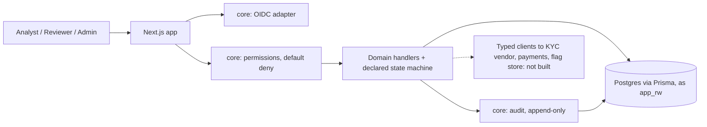
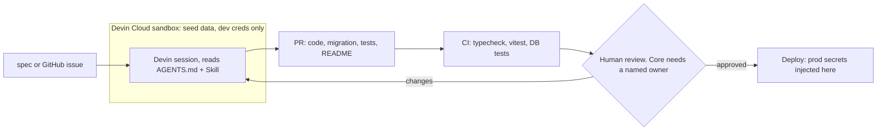

# Internal tools on Devin Cloud

Context: a fintech with ~60 engineers spends about $250K/yr on Power Apps for three internal tools (KYC review queue, refunds dashboard, feature flag admin) and has ten more planned. The VP of Eng wants to know if the team can build these with Devin instead and drop the license.

I spent an evening finding out. This repo is what came out of it. My take, in one line: Devin can build and maintain the apps, it can't replace the stuff Power Apps does underneath them (login, hosting, audit evidence, someone on call), so build the new tools this way on a small foundation that a human owns, leave the existing three alone until renewal, and run a 4-week pilot before deciding anything bigger. Details in the Loom and in `economics.md`.

## What's here

- `packages/core` - the foundation. Mock OIDC adapter, permissions as data (default deny), an audit log the app role can’t update or delete at the Postgres level, a declared state machine. I specified it, tested it by hand (region scoping, the transitions, the DB grant), and read the one later change to it line by line. This is the part I would not hand to an agent unsupervised on a compliance tool.
- `apps/kyc-queue` - first app. Devin built it from `specs/kyc-queue.md`. Analyst sees cases for their region sorted by SLA, works one through pending / in_review / approved / rejected / escalated with a required reason, everything lands in the audit log.
- `apps/feature-flags` - second app, same Skill, different spec. The point of this one was to time it.
- `AGENTS.md`, `.agents/skills/new-internal-tool/SKILL.md` - house rules and the recipe. Honestly this is the thing that replaces Power Apps. Spec goes in, PR comes out.
- `specs/` - half a page per tool.
- `log.md` - every Devin task, what it did, what I fixed.
- `economics.md` - the money.
- `docs/` - screenshots.

## Running it

Docker, Node 22 (20 works, you get a warning), pnpm 9.

If you have Postgres running locally on 5432, stop it. I didn't, and the first migrations went into Homebrew's Postgres instead of the container. Took me a few minutes to figure out.

```
cp .env.example .env
pnpm install
pnpm dev     # postgres up, migrate, seed, serve
pnpm test    # 426 unit tests
```

KYC queue is on http://localhost:3001. Users: Ana Analyst (US-WEST only), Sam Senior (sees everything, resolves escalations), Ada Admin.
Feature flags is on http://localhost:3002. Users: engineer (staging only), admin (staging and prod), viewer.

Worth doing: log in as Ana, open an in_review case, escalate it. You'll have to pick a category. Log in as Sam, approve it. Look at the audit tab. Then:

```
docker compose exec db psql -U postgres -d kyc_queue -c "SET ROLE app_rw; UPDATE audit_log SET reason='x' WHERE true;"
```

Permission denied. The app can't edit its own audit trail.

## How Devin was used

One Devin Cloud session, four tasks, Pro plan ($20/mo), nothing on-demand. About 15 minutes of Devin actually working. 1h47m of my time from empty repo to last merge, most of it reading diffs and clicking through the apps. That ratio is the point: the typing got cheap, the reviewing didn't.

| Task | What | Devin time | Result |
|---|---|---|---|
| 1 | core + KYC queue from spec | 7m25s + 1m48s | PR #1. +5096 lines, 299 tests. Listed 12 things the spec didn't say and what it decided |
| 2 | feature-flags, same Skill | 2m32s | PR #2. 46 files, +1467 lines. Didn't touch core. I changed nothing after review |
| 2b | core change I authorized: mock IdP takes users from the app | 1m37s | PR #3 (core, +139 -20) and PR #4, stacked so #2 stayed clean |
| 3 | GitHub issue #5, written like compliance would write it: escalations need a category | 1m22s | PR #6. Migration, server-side validation, picker, audit, tests. Merged as-is |

Things I had to step in on, most important first:

1. **Race in the core migration.** `CREATE ROLE app_rw` had an `IF NOT EXISTS` guard, which is right, except two apps run the migration at the same time against one Postgres, and roles are cluster-wide. Both checked, both created, one lost. Worked on Devin's VM, failed on my laptop. I wrapped it in an exception handler. This is the kind of thing I mean when I say core needs a human. The guard looked correct and wasn't.
2. **It almost rewrote git history.** GitGuardian flagged the dev Postgres password in docker-compose and Devin started reasoning about force-pushing to make the scanner go green. I told it no, move the password to `.env.example`. It did, and then told me there hadn't been a real CI failure in the first place, which was true.
3. **It asked me a design question instead of guessing.** Halfway through app #2 it found that core's mock login only knew the KYC roles. It stopped and asked whether core should hardcode more users or let apps pass their own. I picked the second because that's how a real IdP behaves, and gave it permission to change core for that one thing.

Stuff it got right that I didn't ask for: rendering prod rows as read-only for engineers instead of failing on click, rejecting a category sent on a non-escalate move, a test that a rejected escalate leaves no audit row.

## Architecture

Inside each app:



How apps get built, which is the actual Power Apps replacement:



There’s no production here, but the shape is: Devin’s sandbox gets seed data and dev credentials; real secrets would be injected at deploy, after a human approves. Core changes are rare and need sign-off. App changes don’t.

## What I skipped

Real IdP, connectors, mobile, hash-chained audit, and the third app. The refunds dashboard is the same shape as the KYC queue. Another twenty minutes to build it, nothing new learned. None of these are hard problems, they're just time.

## Timing

Empty repo at 8:05 PM. Last merge 9:52 PM. Then this.

---

## Developer reference

The section below is Devin's, from PR #1 and #3. Kept because it's accurate and the commands are handy.

pnpm workspaces monorepo. See `AGENTS.md` for conventions and `.agents/skills/new-internal-tool` for scaffolding.

| Path | What |
|---|---|
| `packages/core` | Shared: mock OIDC auth + signed session, permissions (default deny), `audit()`, state machine |
| `apps/_template` | Minimal Next.js app wired to core. Copied by the skill for new tools |
| `apps/<tool>` | One tool per folder, each with its own Postgres database |

```bash
pnpm install
pnpm dev        # postgres up -> prisma migrate deploy -> seed -> all apps (template :3000, kyc-queue :3001, feature-flags :3002)
pnpm test       # vitest unit tests (no DB needed)
pnpm test:db    # vitest integration tests against the dev DB (run after `pnpm dev`)
pnpm test:e2e   # Playwright smoke tests (resets app DBs; `pnpm --filter @internal/kyc-queue exec playwright install chromium` once)
pnpm typecheck
```

Sign in at `/login` as one of the mock users: `analyst` (US-WEST), `senior` (senior_reviewer, all regions), `admin`. Apps can supply their own mock users with `getAuthAdapter({ users })` / `createMockAuth({ users })` and `signIn(sub, adapter)`; without `users` the three above are used.

Database roles:

- Migrations run as the owner (`MIGRATE_DATABASE_URL`).
- Apps run as `app_rw` (`DATABASE_URL`). The core migration grants it `SELECT, INSERT` on `audit_log` only — no `UPDATE`, `DELETE` or `TRUNCATE`. Dev DB passwords live in the root `.env.example` (copied to `.env` by `pnpm dev`); `docker/postgres-init.sh` sets the `app_rw` login on first DB start.